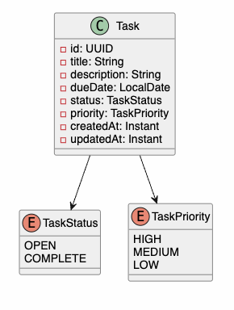
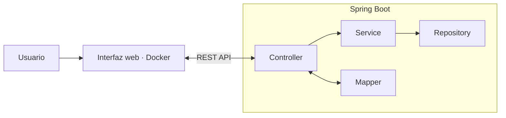

# Devtiro-task-app

API REST en Spring Boot para una aplicación de gestión de tareas.
## Modelo de dominio

El modelo de dominio se compone de la clase Task y dos enums: `TaskStatus` para el estado y `TaskPriority` para la prioridad.



## Arquitectura



## Estructura del proyecto

```text
src/
├── main/
│   ├── java/Devtiro/
│   │   ├── Exception/         # Excepciones de la aplicación
│   │   └── Task/
│   │       ├── controller/   # Endpoints y manejo de errores HTTP
│   │       ├── domain/       # Modelos y solicitudes del dominio
│   │       │   ├── dto/      # Datos de entrada y salida de la API
│   │       │   └── entity/   # Entidades y enumeraciones
│   │       ├── mapper/       # Conversión entre DTOs y modelos
│   │       │   └── impl/     # Implementaciones de los mappers
│   │       ├── repository/   # Acceso a datos
│   │       └── service/      # Interfaces de operaciones de negocio
│   │           └── impl/     # Implementaciones de la lógica de negocio
│   └── resources/            # Configuración y recursos
└── test/                     # Pruebas
```

## Endpoints

| Método | Ruta | Acción | Respuesta |
|---|---|---|---|
| GET | `/api/v1/tasks` | Listar tareas | 200 OK |
| POST | `/api/v1/tasks` | Crear tarea | 201 Created |
| PUT | `/api/v1/tasks/{taskId}` | Actualizar tarea | 200 OK |
| DELETE | `/api/v1/tasks/{taskId}` | Eliminar tarea | 204 No Content |
